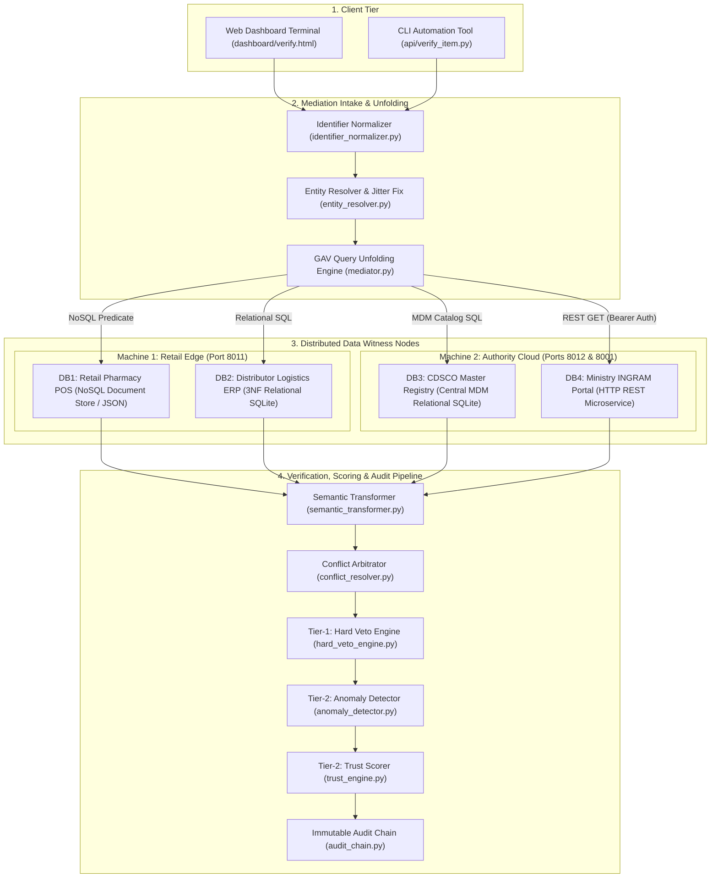
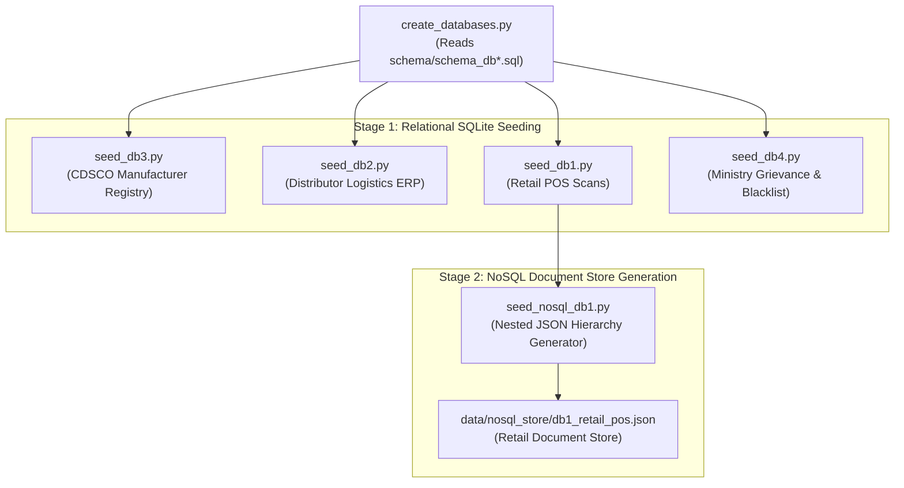
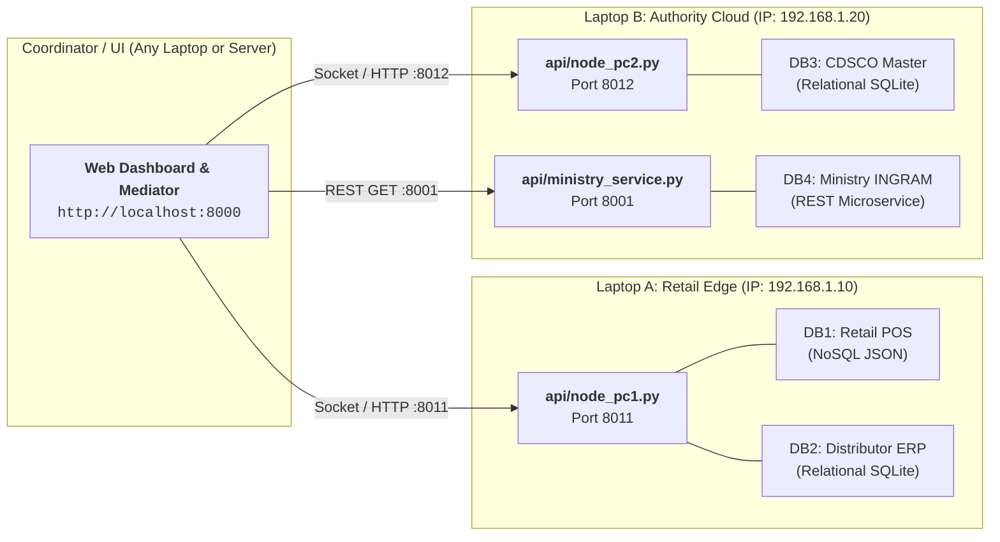
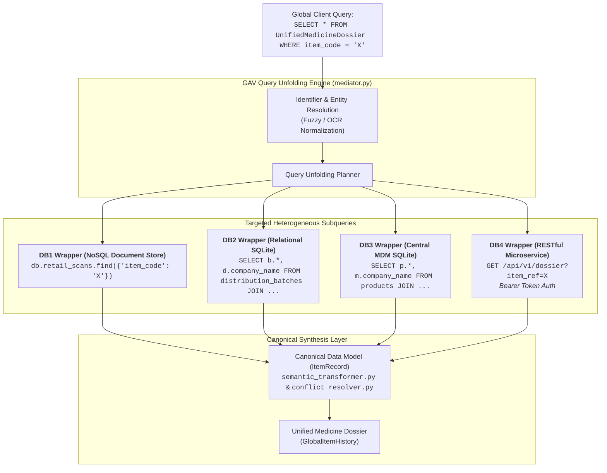
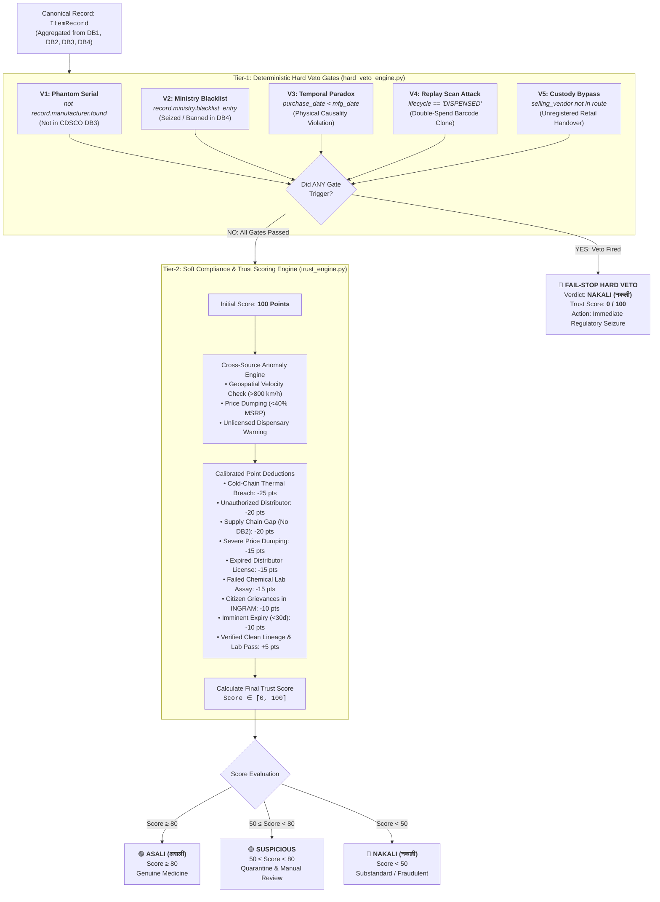
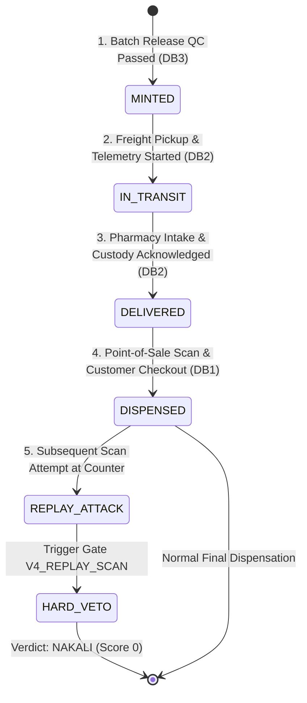
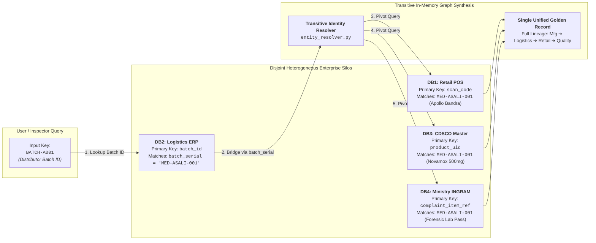

# ASALI (असली) vs NAKALI (नकली)
## The Complete Zero-to-100 Master Architecture, Codebase, and Theory Guide

---

## TABLE OF CONTENTS
1. [Executive Overview & The Real-World Crisis](#1-executive-overview--the-real-world-crisis)
2. [Why Not a Single Monolithic Database? (The Core IIA Problem)](#2-why-not-a-single-monolithic-database-the-core-iia-problem)
3. [Global Architecture & Distributed Mesh Topology](#3-global-architecture--distributed-mesh-topology)
4. [Data Generation & Seeding Pipeline (Zero-to-One)](#4-data-generation--seeding-pipeline-zero-to-one)
5. [The 4 Heterogeneous Databases: Schemas & Meanings](#5-the-4-heterogeneous-databases-schemas--meanings)
6. [Multi-PC & Docker Distributed Deployment](#6-multi-pc--docker-distributed-deployment)
7. [The Modular Wrapper Layer](#7-the-modular-wrapper-layer)
8. [Global-as-View (GAV) Mediator & Query Unfolding](#8-global-as-view-gav-mediator--query-unfolding)
9. [Detection Logic: Two-Tier Hybrid Architecture](#9-detection-logic-two-tier-hybrid-architecture)
   - [Tier-1: Deterministic Hard Veto Gates](#tier-1-deterministic-hard-veto-gates)
   - [Tier-2: Anomaly Detection Engine](#tier-2-anomaly-detection-engine)
   - [Tier-2: Probabilistic Soft Trust Scoring](#tier-2-probabilistic-soft-trust-scoring)
   - [Lifecycle State Machine Tracking](#lifecycle-state-machine-tracking)
10. [The 8 Information Integration & Architecture (IIA) Challenges (Deep Dive with Code)](#10-the-8-information-integration--architecture-iia-challenges)
    - [Challenge 01: Syntactic Heterogeneity & GAV Query Unfolding](#challenge-01-syntactic-heterogeneity--gav-query-unfolding)
    - [Challenge 02: Structural Heterogeneity & Hierarchy Flattening](#challenge-02-structural-heterogeneity--hierarchy-flattening)
    - [Challenge 03: Semantic & Scientific Unit Heterogeneity](#challenge-03-semantic--scientific-unit-heterogeneity)
    - [Challenge 04: Multi-Metric Fuzzy Entity Resolution & OCR Jitter](#challenge-04-multi-metric-fuzzy-entity-resolution--ocr-jitter)
    - [Challenge 05: Declarative Conflict Arbitration & Contradictions](#challenge-05-declarative-conflict-arbitration--contradictions)
    - [Challenge 06: CAP Theorem, Network Partition & Circuit Breakers](#challenge-06-cap-theorem-network-partition--circuit-breakers)
    - [Challenge 07: Schema Evolution & GS1 Digital Link Drift](#challenge-07-schema-evolution--gs1-digital-link-drift)
    - [Challenge 08: Transitive Multi-Database Identity Graph (Disjoint Silos)](#challenge-08-transitive-multi-database-identity-graph-disjoint-silos)
11. [Cryptographic Immutable Audit Chain](#11-cryptographic-immutable-audit-chain)
12. [Frontend Architecture & Tactile Ceramic UI System](#12-frontend-architecture--tactile-ceramic-ui-system)
13. [Step-by-Step Execution, Verification & Viva Cheat-Sheet](#13-step-by-step-execution-verification--viva-cheat-sheet)

---

# 1. Executive Overview & The Real-World Crisis

In the pharmaceutical supply chain, counterfeit medications (**Nakali**) kill hundreds of thousands of people each year. Substandard drugs range from:
1. **Chalk & Starch Fakes**: Packaging printed to look identical to Cipla Novamox, but with zero active pharmaceutical ingredient (API).
2. **Toxic Contamination**: Medicines formulated with lethal industrial solvents (such as Diethylene Glycol in cough syrups).
3. **Barcode Cloning / Digital Duplication**: A counterfeiter buys one legitimate box, copies its 2D DataMatrix code onto 10,000 fake boxes, and distributes them simultaneously across hundreds of pharmacies.
4. **Cold-Chain Spoilage**: Vaccines, insulins, or biologicals that experienced heat excursion ($> 8^\circ\text{C}$) during transport, denaturing the protein structure and rendering the drug ineffective or toxic.
5. **Black Market / Illicit Diversion**: Medicines stolen from hospital dispensaries or routed through unlicensed vendors.

**Asali** (Swahili/Hindi for *"Pure / Genuine / Authentic"*) is a federated Information Integration platform engineered to verify any medication pack in real time at point-of-sale or hospital dispensation.

---

# 2. Why Not a Single Monolithic Database? (The Core IIA Problem)

Beginners often ask:
> *"Why not just put all pharmaceutical data into one giant Oracle or PostgreSQL database in the cloud?"*

In the real world, a single database is **technically, commercially, and legally impossible**:

1. **Autonomous Enterprise Boundaries**:
   - **Manufacturers** (e.g., Cipla, Sun Pharma, Pfizer) treat their batch release formulas and ERP cost data as trade secrets. They will never give direct database write access to external logistics companies.
   - **Logistics & Freight Forwarders** run their own warehouse management systems (often SAP or custom relational DBs).
   - **Retail Dispensaries / Pharmacies** run thousands of independent Point-of-Sale (POS) systems (often streaming document stores or lightweight NoSQL engines).
   - **Government Regulatory Agencies** (CDSCO, Ministry of Consumer Affairs) maintain statutory master lists and blacklists completely isolated from commercial networks.
2. **System & Syntactic Heterogeneity**:
   - Different stakeholders choose different databases optimized for their specific workload:
     - Retail POS terminals require high-velocity NoSQL document streams.
     - Logistics ERP requires 3NF relational databases with foreign keys.
     - Central regulators publish secure REST APIs.
3. **Regulatory & Geographic Sovereignty**:
   - Data residency laws and antitrust regulations prevent centralized commercial monopolies over health data.

**The Solution**: **Global-as-View (GAV) Federated Query Mediation**.
Instead of centralizing data, Asali centralizes **logic**. The databases remain completely autonomous, heterogeneous, and distributed. The Asali Mediator issues distributed subqueries on the fly, translates syntaxes, resolves typos, arbitrates contradictions, and calculates a unified verdict.

---

# 3. Global Architecture & Distributed Mesh Topology



The system operates across **3 tiers**:
1. **Client Tier**: Modern web application (`index.html`, `verify.html`) and Python automation CLI (`api/verify_item.py`).
2. **Mediation Tier**: The federated query coordinator, running the GAV resolution pipeline and the Two-Tier verification engine.
3. **Data Witness Tier**: 4 physically independent, heterogeneous database nodes.

---

# 4. Data Generation & Seeding Pipeline (Zero-to-One)

All data in Asali is deterministically generated from scratch to model realistic pharmaceutical scenarios.



### Step 1: Schema Creation (`create_databases.py`)
- Reads schema definition files from `schema/`:
  - `schema_db1.sql` $\to$ DB1
  - `schema_db2.sql` $\to$ DB2
  - `schema_db3.sql` $\to$ DB3
  - `schema_db4.sql` $\to$ DB4
- Deletes any stale SQLite databases and compiles clean binary database files in `databases/`.

### Step 2: Relational Seeding (`data/seed_db*.py`)
- **`seed_db3.py` (CDSCO Manufacturer Registry)**:
  - Creates 5 licensed Indian pharmaceutical giants: `MFG-CIPLA-01`, `MFG-SUN-02`, `MFG-DRREDDY-03`, `MFG-LUPIN-04`, `MFG-ZYDUS-05`.
  - Injects product catalog records: `Novamox 500mg`, `Pantocid 40mg`, `Ciplox 500mg`, `Azithral 500mg`, `Insugen 40IU`.
  - Attaches ISO/GMP certificates and batch QC release signatures (`qc_passed = 1`).
- **`seed_db2.py` (Distributor Logistics ERP)**:
  - Creates cold-chain freight companies: `DIST-APOLLO-LOG`, `DIST-TRANSMED-EXP`, `DIST-BLUE-DART-PHARMA`.
  - Generates distribution batches with transport vehicle numbers, source warehouses, destination pharmacy IDs, and GPS telemetry URLs.
- **`seed_db1.py` (Point-of-Sale Scans)**:
  - Creates licensed pharmacies (`VND-MUM-001` Apollo Mumbai, `VND-BLR-002` MedPlus Bengaluru) and unlicensed rogue kiosks (`VND-999` Unlicensed Chemist).
  - Injects scan records with timestamps, prices, payment methods (UPI, Cash), and device IDs.
- **`seed_db4.py` (Ministry of Consumer Affairs & INGRAM)**:
  - Injects consumer complaints, forensic lab reports (chemical assay potency match), and the statutory `ministry_blacklist`.

### Injected Test Cases:
| Test Code | Scenario Type | Why It Exists & What It Proves |
| :--- | :--- | :--- |
| `MED-ASALI-001` | **Genuine Baseline** | Verified in DB3, authorized in DB2, scanned legally in DB1, clean in DB4. Score: 100/100 (**ASALI**). |
| `MED-ASALI-002` | **Barcode Cloning** | Scanned in 5 different stores across Mumbai, Pune, and Bengaluru in 28 minutes. Proves geospatial velocity contradiction ($> 800\text{ km/h}$). |
| `MED-RECALL-001` | **Toxic Contamination** | Active recall in DB3 and gazetted blacklist in DB4. Proves Authority Precedence Policy. |
| `MED-UNAUTH-001` | **Black Market Diversion** | Sold by unlicensed kiosk `VND-999` with zero distributor records in DB2. Proves Supply Chain Gap detection. |
| `MED-ASALI-009` | **Cold-Chain Excursion** | Temperature spike to $14.2^\circ\text{C}$ ($> 8^\circ\text{C}$). Proves Semantic Unit Normalization and potency risk penalty. |
| `MED-NAKALI-001` | **Phantom Fake** | Sold at retail in DB1, but **zero manufacturer record in DB3**. Proves Tier-1 Hard Veto. |

### Step 3: Native NoSQL Document Conversion (`data/seed_nosql_db1.py`)
In modern retail, thousands of POS cash registers stream semi-structured JSON directly into document stores like MongoDB.
`seed_nosql_db1.py` converts DB1 relational rows into:
`data/nosql_store/db1_retail_pos.json`
with nested document trees:
```json
{
  "_id": "EVT-MUM-001",
  "scan_code": "MED-ASALI-001",
  "document_type": "retail_pos_scan",
  "dispensary": {
    "vendor_id": "VND-MUM-001",
    "name": "Apollo Pharmacy Bandra",
    "geo": { "city": "Mumbai", "coordinates": { "lat": 19.0760, "lon": 72.8777 } }
  },
  "transaction": {
    "amount": 48.0,
    "currency": "INR",
    "payment": { "method": "upi", "device_id": "POS-MUM-01" }
  },
  "quality_assurance": { "anomaly_flag": 0, "verified_at_counter": true }
}
```

---

# 5. The 4 Heterogeneous Databases: Schemas & Meanings

### Database 1: Retail Purchase Registry (DB1)
- **Role**: High-velocity retail scan events at point of sale.
- **Paradigm**: NoSQL Document Store (JSON) with relational SQLite backup.
- **Primary Integration Key**: `scan_code`.
- **Core Entities**:
  - `vendors`: Store ID, name, license number, license expiry date, active status.
  - `purchase_events`: Scan code, scan timestamp, vendor ID, price paid, payment method, device ID.
  - `scan_anomaly_log`: Rapid rescan alerts, multi-location flags.

### Database 2: Distributor Logistics Ledger (DB2)
- **Role**: Tracks middle-mile transportation from factory to pharmacy.
- **Paradigm**: 3NF Relational SQL (SQLite).
- **Primary Integration Key**: `batch_serial`.
- **Core Entities**:
  - `distributors`: Freight license number, cold-chain capability flag, authorization status.
  - `distribution_batches`: Batch serial, distributor ID, source warehouse, destination vendor ID, dispatch date, arrival date, `cold_chain_maintained` flag, temperature log URL, vehicle registration.
  - `distributor_vendor_contracts`: Legal contracts between logistics firms and pharmacies.
  - `return_log`: Damaged or rejected batch shipments.

### Database 3: CDSCO Master Manufacturer Registry (DB3)
- **Role**: The statutory Golden Record of genuine medicines.
- **Paradigm**: Central Master Data Management (MDM) Relational Catalog (SQLite).
- **Primary Integration Key**: `product_uid`.
- **Core Entities**:
  - `manufacturers`: Manufacturer ID, company name, GMP certification number, license expiry.
  - `products`: Product UID, brand name, generic formulation, strength, batch number, manufacture date, expiry date, registration number, `requires_cold_chain` flag, `is_recalled` flag, MSRP.
  - `authorized_distributors`: Whitelist of approved logistics partners per manufacturer.
  - `batch_release_certs`: QC laboratory release certificate with cryptographic hash.

### Database 4: Ministry of Consumer Affairs Grievance Portal (DB4)
- **Role**: Government oversight, consumer complaints, and legal blacklists.
- **Paradigm**: HTTP RESTful Web Microservice (`api/ministry_service.py` on Port 8001).
- **Primary Integration Key**: `complaint_item_ref` / `item_ref`.
- **Core Entities**:
  - `complaints`: Citizen complaint reports, adverse reactions, complaint severity (`critical`, `high`).
  - `ministry_blacklist`: Legally banned or seized counterfeit codes with immediate police seizure mandate.
  - `lab_reports`: Independent government chemical test results (`active_ingredient_match`, `contaminants_found`, result `pass`/`fail`).
  - `public_alerts`: Gazette safety advisories broadcast to consumers.

---

# 6. Multi-PC & Docker Distributed Deployment

In an enterprise environment, these databases reside on different machines across corporate firewalls.

### Topology Configuration (`integration/distributed_config.py`)
`distributed_config.py` provides dynamic endpoint resolution:
```python
# Reads environment variables with seamless fallback to localhost
PC1_HOST = os.environ.get("PC1_HOST", "127.0.0.1")
PC1_PORT = int(os.environ.get("PC1_PORT", "8011"))

PC2_HOST = os.environ.get("PC2_HOST", "127.0.0.1")
PC2_PORT = int(os.environ.get("PC2_PORT", "8012"))
DB4_PORT = int(os.environ.get("DB4_PORT", "8001"))
```

### Docker Compose Architecture (`docker-compose.yml`)
```yaml
services:
  asali-pc1-retail:
    build: .
    container_name: asali-pc1-retail
    command: ["python3", "api/node_pc1.py", "--port", "8011"]
    ports: ["8011:8011"]
    networks: [asali-network]

  asali-pc2-authority:
    build: .
    container_name: asali-pc2-authority
    command: ["python3", "api/node_pc2.py", "--port", "8012"]
    ports: ["8012:8012", "8001:8001"]
    networks: [asali-network]

  asali-mediator:
    build: .
    container_name: asali-mediator
    command: ["python3", "-m", "http.server", "8000", "--directory", "dashboard"]
    ports: ["8000:8000"]
    environment:
      - PC1_HOST=asali-pc1-retail
      - PC2_HOST=asali-pc2-authority
    networks: [asali-network]
```

To run on **two physical laptops on the same Wi-Fi**:



1. Laptop A (IP `192.168.1.10`): Run `python3 api/node_pc1.py --port 8011`.
2. Laptop B (IP `192.168.1.20`): Run `python3 api/node_pc2.py --port 8012` and `python3 api/ministry_service.py --port 8001`.
3. Laptop A or Server: Set `PC1_HOST=192.168.1.10 PC2_HOST=192.168.1.20 python3 -m http.server 8000 --directory dashboard`.

---

# 7. The Modular Wrapper Layer

In Information Integration, a **Wrapper** encapsulates a specific data storage technology, translating high-level canonical query requests into native queries and returning standardized Python dictionaries.

All wrappers inherit from `BaseWrapper` ([integration/wrappers/base_wrapper.py](file:///Users/sayan/Sayan/Study/IIA/Project2_Asali_Nakali/integration/wrappers/base_wrapper.py)):
```python
class BaseWrapper(ABC):
    def __init__(self, source_id: str):
        self.source_id = source_id

    @abstractmethod
    def fetch_by_key(self, key_value: str) -> Dict[str, Any]:
        """Fetch raw records matching the primary integration key."""
        pass

    @abstractmethod
    def health_check(self) -> bool:
        """Verify underlying connection / file availability."""
        pass
```

### 1. NoSQL Wrapper (`nosql_wrapper.py`)
- Reads `data/nosql_store/db1_retail_pos.json`.
- Streams documents into memory, evaluates predicates (`doc["scan_code"] == key`), and flattens nested structures.
- Records execution latency in milliseconds for query telemetry.

### 2. Relational SQL Wrapper (`sql_wrapper.py`)
- Used for DB2 and DB3.
- Opens SQLite connection with `conn.row_factory = sqlite3.Row`.
- Executes foreign key `JOIN` queries:
  ```sql
  SELECT p.*, m.company_name, m.license_no, m.gmp_certified
  FROM products p
  JOIN manufacturers m ON p.manufacturer_id = m.manufacturer_id
  WHERE p.product_uid = ?
  ```

### 3. REST API Wrapper (`rest_wrapper.py`)
- Used for DB4 (Ministry Web Microservice).
- Issues HTTP `GET` requests to `http://<host>:8001/api/v1/dossier?item_ref=<key>`.
- Includes bearer authorization headers (`Authorization: Bearer CDSCO-MCA-2026-KEY`).
- Implements a **Circuit Breaker** pattern: if the remote HTTP service drops, it gracefully logs network degradation and proxies to local storage without crashing the user session.

---

# 8. Global-as-View (GAV) Mediator & Query Unfolding

The core innovation of Asali is its **Global-as-View (GAV)** architecture implemented in `integration/mediator.py`.

In GAV, the **Global Schema** is defined as a view over the underlying **Source Schemas**:
$$\text{Global Schema } \mathcal{G} = \mathcal{V}(\mathcal{S}_1, \mathcal{S}_2, \mathcal{S}_3, \mathcal{S}_4)$$

When an application queries the global concept `UnifiedMedicineDossier`, the Mediator **unfolds** the query into physical subqueries:



### Unfolding Implementation in Code ([mediator.py](file:///Users/sayan/Sayan/Study/IIA/Project2_Asali_Nakali/integration/mediator.py#L109-L154)):
```python
def explain_query_unfolding(self, query_code: str) -> Dict[str, Any]:
    entity_res = self.entity_engine.resolve_item_code(query_code)
    canonical = entity_res.resolved_canonical

    return {
        "global_query": f"SELECT * FROM UnifiedMedicineDossier WHERE item_code = '{query_code}'",
        "entity_linkage": {
            "raw_input": query_code,
            "canonical_target": canonical,
            "confidence_score": entity_res.confidence_score,
            "is_fuzzy_match": entity_res.is_fuzzy_linked
        },
        "subqueries": [
            {
                "target_source": "DB1 Retail Pharmacy POS",
                "engine": "NoSQL Document Store",
                "unfolded_operation": f"db.retail_scans.find({{'item_code': '{canonical}'}})",
                "purpose": "Detect duplicate scans, velocity anomalies, and unauthorized vendor sales"
            },
            {
                "target_source": "DB2 Distributor ERP",
                "engine": "Relational SQL (SQLite)",
                "unfolded_operation": f"SELECT b.*, d.company_name FROM distribution_batches b JOIN distributors d ON b.distributor_id = d.distributor_id WHERE b.batch_serial = '{canonical}'",
                "purpose": "Audit supply chain custody, cold-chain temperature excursion, transit route"
            },
            {
                "target_source": "DB3 CDSCO Master Registry",
                "engine": "Central MDM Catalog (SQLite)",
                "unfolded_operation": f"SELECT p.*, m.company_name FROM products p JOIN manufacturers m ON p.manufacturer_id = m.manufacturer_id WHERE p.product_uid = '{canonical}'",
                "purpose": "Verify statutory existence, authorized distributors, batch certificate QC"
            },
            {
                "target_source": "DB4 Ministry INGRAM Portal",
                "engine": "HTTP RESTful Microservice",
                "unfolded_operation": f"GET /api/v1/dossier?item_ref={canonical}",
                "purpose": "Fetch active recalls, citizen grievance reports, laboratory chemical tests"
            }
        ]
    }
```

---

# 9. Detection Logic: Two-Tier Hybrid Architecture

A critical innovation in Asali is resolving the **Subtractive Scoring Paradox**.

### The Problem with Simple Additive/Subtractive Scoring:
Imagine an engine that starts with a score of 100 and subtracts points for errors:
- If a medicine fails the manufacturer check: subtract 40 points.
- Score: $100 - 40 = 60$.
- Result: **60 points = "SUSPICIOUS - REVIEW REQUIRED"**.

**This is unacceptable in healthcare.** If a medicine was never manufactured by any licensed pharmaceutical company, it is not "suspicious" — it is a **100% fake (Nakali)**. It must have a score of $0$ and trigger immediate police escalation.

### The Solution: Two-Tier Hybrid Architecture
1. **Tier-1: Hard Veto Gates** (Deterministic, zero-tolerance, fail-stop).
2. **Tier-2: Soft Compliance Scoring** (Probabilistic, weighted deductions).



---

### Tier-1: Deterministic Hard Veto Gates (`hard_veto_engine.py`)

If ANY of these 5 gates fire, evaluation halts immediately:
$$\text{Verdict} = \mathbf{NAKALI}, \quad \text{Trust Score} = 0$$

```python
class HardVetoEngine:
    def evaluate(self, record: ItemRecord, lifecycle_state: Optional[str] = None) -> VetoResult:
        gates = [
            self._v1_phantom_serial(record),
            self._v2_ministry_blacklist(record),
            self._v3_temporal_paradox(record),
            self._v4_replay_scan(record, lifecycle_state),
            self._v5_custody_bypass(record),
        ]
        triggered = [g for g in gates if g.triggered]
        return VetoResult(vetoed=len(triggered) > 0, gates=gates)
```

#### The 5 Hard Veto Gates:
1. **`V1_PHANTOM_SERIAL`**:
   - **Logic**: `not record.manufacturer.found`
   - **Meaning**: The serial code exists in the retail shop (DB1), but was never registered in the Central CDSCO Manufacturer Database (DB3). It is a pure counterfeit manufactured in an illicit facility.
2. **`V2_MINISTRY_BLACKLIST`**:
   - **Logic**: `record.ministry.blacklist_entry and blacklist_entry["active"] == 1`
   - **Meaning**: The drug code was explicitly seized, tested, and blacklisted by government gazette notice for lethal toxicity or illegal distribution.
3. **`V3_TEMPORAL_PARADOX`**:
   - **Logic**: `purchase_date < manufacture_date`
   - **Meaning**: The point-of-sale customer receipt timestamp in DB1 is earlier than the factory manufacturing release date in DB3. This physical causality violation proves fraudulent barcode generation.
4. **`V4_REPLAY_SCAN` (Double-Spend / Barcode Cloning)**:
   - **Logic**: `lifecycle_state == "DISPENSED" and is_new_checkout_scan`
   - **Meaning**: A 2D DataMatrix code on a prescription box can only be dispensed to a patient **once**. If that same code is scanned again at another counter, it is a cloned duplicate.
5. **`V5_CUSTODY_BYPASS`**:
   - **Logic**: `selling_vendor_id not in authorized_destination_vendors`
   - **Meaning**: The medicine is being sold by a dispensary that was never part of the legal distributor dispatch route logged in DB2.

---

### Tier-2: Anomaly Detection Engine (`anomaly_detector.py`)

When all Tier-1 gates pass, the **Anomaly Detector** inspects temporal and cross-source patterns:

```python
class AnomalyDetector:
    def detect(self, record: ItemRecord) -> AnomalyReport:
        flags = []
        flags += self._check_multi_location(record)      # Barcode cloning across cities
        flags += self._check_temporal_consistency(record)# Handoff sequence
        flags += self._check_price_anomaly(record)       # Price dumping
        flags += self._check_velocity(record)            # Volume spikes
        flags += self._check_unlicensed_vendor(record)   # Rogue pharmacy
        flags += self._check_supply_chain_gap(record)    # Missing distributor
        flags += self._check_cold_chain_risk(record)     # Temperature breach
        return AnomalyReport(flags=flags, clean=len(flags) == 0)
```

#### Geospatial Velocity Feasibility Formula:
To detect barcode cloning, Asali calculates the minimum travel velocity between consecutive store scans:
$$v = \frac{\text{HaversineDistance}(\text{City}_1, \text{City}_2)}{\Delta t}$$
If $v > 800\text{ km/h}$ (faster than commercial jet speed) between pharmacy scans, `MULTI_LOCATION_SCAN` fires automatically.

---

### Tier-2: Probabilistic Soft Trust Scoring (`trust_engine.py`)

When Tier-1 passes, the drug begins with **100 Points** and is subjected to calibrated deductions:

```python
score = 100

# 1. Cold-Chain Thermal Excursion (-25)
if requires_cold_chain and cold_chain_maintained == 0:
    score -= 25

# 2. Unauthorized Distributor Route (-20)
if not distributor.get("is_authorized", 1):
    score -= 20

# 3. Supply Chain Gap (-20)
# Item sold at retail but has zero distributor dispatch batch in DB2
if record.purchase.found and not record.distribution.found:
    score -= 20

# 4. Severe Price Dumping (-15)
# Sold at less than 40% of manufacturer MSRP
if price_paid < 0.40 * msrp:
    score -= 15

# 5. Revoked Distributor License (-15)
if distributor_license_expired:
    score -= 15

# 6. Failed Forensic Lab Test (-15)
if lab_report.get("result") == "fail":
    score -= 15

# 7. Citizen Complaints in INGRAM (-10)
if len(record.ministry.complaints) > 0:
    score -= 10

# 8. Imminent Expiry Date (-10)
if days_to_expiry < 30:
    score -= 10

# Bonus (+5)
if clean_lineage and lab_report.get("result") == "pass":
    score = min(100, score + 5)
```

### Verdict Decision Boundary:
$$\text{Verdict} = \begin{cases} 
\mathbf{ASALI} & \text{if } \text{Score} \ge 80 \text{ and } \text{Tier-1 Passed} \\
\mathbf{SUSPICIOUS} & \text{if } 50 \le \text{Score} < 80 \text{ and } \text{Tier-1 Passed} \\
\mathbf{NAKALI} & \text{if } \text{Score} < 50 \text{ or } \text{Tier-1 Veto Fired}
\end{cases}$$

---

### Lifecycle State Machine Tracking (`lifecycle_state.py`)

A legitimate medicine pack moves through a strictly sequential state machine:
$$\mathbf{MINTED} \longrightarrow \mathbf{IN\_TRANSIT} \longrightarrow \mathbf{DELIVERED} \longrightarrow \mathbf{DISPENSED}$$



If an item's current state is `DISPENSED`, any subsequent checkout scan is flagged as a duplicate clone.

---

# 10. The 8 Information Integration & Architecture (IIA) Challenges

Asali is built as a complete academic research platform solving 8 core Information Integration challenges:

---

### Challenge 01: Syntactic Heterogeneity & GAV Query Unfolding
- **Theoretical Problem**: Disparate storage engines speak fundamentally different query languages: NoSQL JSON query predicates vs ANSI SQL 3NF JOINs vs RESTful HTTP GET.
- **Asali Implementation**: [mediator.py](file:///Users/sayan/Sayan/Study/IIA/Project2_Asali_Nakali/integration/mediator.py) defines a Global-as-View query unfolding engine.
- **Code**:
  ```python
  # Unfolds single canonical query into 4 distinct native syntaxes
  unfolded_plans = {
      "db1": "db.retail_scans.find({'item_code': '...'})",
      "db2": "SELECT b.*, d.company_name FROM distribution_batches b JOIN distributors d ...",
      "db3": "SELECT p.*, m.company_name FROM products p JOIN manufacturers m ...",
      "db4": "GET /api/v1/dossier?item_ref=... [Bearer CDSCO-MCA-2026-KEY]"
  }
  ```

---

### Challenge 02: Structural Heterogeneity & Hierarchy Flattening
- **Theoretical Problem**: Schema mismatch between nested document trees (hierarchical 3D) and flat tabular rows (relational 2D).
- **Asali Implementation**: [nosql_wrapper.py](file:///Users/sayan/Sayan/Study/IIA/Project2_Asali_Nakali/integration/wrappers/nosql_wrapper.py) and [canonical_model.py](file:///Users/sayan/Sayan/Study/IIA/Project2_Asali_Nakali/integration/canonical_model.py).
- **Code**:
  ```python
  # Safe path projection flattening nested NoSQL tree to 2D
  flat_event = {
      "event_id": doc.get("_id"),
      "scan_code": doc.get("scan_code"),
      "vendor_id": doc.get("dispensary", {}).get("vendor_id"),
      "vendor_name": doc.get("dispensary", {}).get("name"),
      "city": doc.get("dispensary", {}).get("geo", {}).get("city"),
      "price_paid": doc.get("transaction", {}).get("amount"),
      "currency": doc.get("transaction", {}).get("currency", "INR")
  }
  ```

---

### Challenge 03: Semantic & Scientific Unit Heterogeneity
- **Theoretical Problem**: Sensor telemetry uses different units of measure ($^\circ\text{F}$, $\text{K}$, $^\circ\text{C}$); currency is logged in foreign currencies (USD, EUR, KES, INR); date formats vary (Unix Epoch, Gazette `DD/MM/YYYY`, ISO-8601).
- **Asali Implementation**: [semantic_transformer.py](file:///Users/sayan/Sayan/Study/IIA/Project2_Asali_Nakali/integration/semantic_transformer.py).
- **Code**:
  ```python
  @staticmethod
  def normalize_temperature(temp_val: Any, source_unit: str = "C") -> Dict[str, Any]:
      val = float(temp_val)
      unit = source_unit.strip().upper()
      if unit in ("F", "FAHRENHEIT"):
          celsius = (val - 32.0) * 5.0 / 9.0
      elif unit in ("K", "KELVIN"):
          celsius = val - 273.15
      else:
          celsius = val
      return {"value_celsius": round(celsius, 2), "canonical_unit": "C"}
  ```

---

### Challenge 04: Multi-Metric Fuzzy Entity Resolution & OCR Jitter
- **Theoretical Problem**: Optical scanners swap glyphs (`O` $\leftrightarrow$ `0`, `I` $\leftrightarrow$ `1`); pharmacists make spelling typos (`"Novamax 500"` vs `"Novamox 500"`; `"Pasyamol"` vs `"Paracetamol"`).
- **Asali Implementation**: [entity_resolver.py](file:///Users/sayan/Sayan/Study/IIA/Project2_Asali_Nakali/integration/entity_resolver.py) and [identifier_normalizer.py](file:///Users/sayan/Sayan/Study/IIA/Project2_Asali_Nakali/integration/identifier_normalizer.py).
- **Code**:
  ```python
  # 1. Optical Glyph Substitution
  OCR_SUBSTITUTIONS = {'O': '0', 'I': '1', 'l': '1', 'Z': '2', 'S': '5', 'B': '8'}

  # 2. Multi-Metric Similarity Fusion (Fellegi-Sunter Paradigm)
  sim = 0.50 * jaro_winkler(s1, s2) + 0.35 * levenshtein_ratio(s1, s2) + 0.15 * soundex_match(s1, s2)
  if sim >= 0.72:
      return ResolutionMatch(canonical_code=catalog_key, confidence=sim)
  ```

---

### Challenge 05: Declarative Conflict Arbitration & Contradictions
- **Theoretical Problem**: Independent databases assert contradicting facts for the exact same item.
- **Asali Implementation**: [conflict_resolver.py](file:///Users/sayan/Sayan/Study/IIA/Project2_Asali_Nakali/integration/conflict_resolver.py) enforces declarative precedence policies.
- **Code**:
  ```python
  # Authority Precedence Policy: Government blacklist strictly overrules manufacturer claim
  if db4_blacklisted and not db3_recalled:
      conflicts.append(ConflictResolutionEntry(
          conflict_type="RECALL_AUTHORITY_CONTRADICTION",
          winning_source="DB4_MINISTRY_OF_CONSUMER_AFFAIRS",
          governing_policy="STATUTORY_DOMINANCE_POLICY",
          arbitrated_value={"is_recalled": True, "action": "IMMEDIATE_SEIZURE"}
      ))
  ```

---

### Challenge 06: CAP Theorem, Network Partition & Circuit Breakers
- **Theoretical Problem**: In a distributed deployment, physical cables disconnect or remote cloud containers crash. A naive mediator hangs or throws HTTP 500 errors.
- **Asali Implementation**: Circuit breakers with dynamic penalty degradation in [api/verify_item.py](file:///Users/sayan/Sayan/Study/IIA/Project2_Asali_Nakali/api/verify_item.py) and [rest_wrapper.py](file:///Users/sayan/Sayan/Study/IIA/Project2_Asali_Nakali/integration/wrappers/rest_wrapper.py).
- **Code**:
  ```python
  try:
      with urllib.request.urlopen(req, timeout=1.5) as resp:
          data = json.loads(resp.read())
  except (urllib.error.URLError, TimeoutError):
      # Trip circuit breaker, fall back gracefully to local snapshot
      circuit_breaker.trip("PC1_NODE")
      # Penalize evidence completeness rather than crashing
      evidence_completeness -= 25  # Missing 1 of 4 database witnesses
  ```

---

### Challenge 07: Schema Evolution & GS1 Digital Link Drift
- **Theoretical Problem**: Remote nodes upgrade schemas asynchronously. When PC1 upgrades from Schema v1.0 (flat JSON) to Schema v2.0 (GS1 Digital Link URI `/01/gtin/21/serial`, minor-unit pricing, and GLN codes), static pipelines fail.
- **Asali Implementation**: [schema_adapter.py](file:///Users/sayan/Sayan/Study/IIA/Project2_Asali_Nakali/integration/schema_adapter.py).
- **Code**:
  ```python
  def adapt_retail_scan(doc: Dict[str, Any]) -> Dict[str, Any]:
      if "digital_link_uri" in doc:
          # Extract serial from GS1 Digital Link regex
          match = re.search(r"/21/([A-Z0-9\-]+)", doc["digital_link_uri"])
          doc["item_code"] = match.group(1)
          # Convert ISO-4217 minor currency units (4800 paise -> 48.00 INR)
          doc["price_paid"] = doc["transaction_pricing"]["amount_gross"] / 100.0
      return doc
  ```

---

### Challenge 08: Transitive Multi-Database Identity Graph (Disjoint Silos)
- **Theoretical Problem**: Autonomous enterprise databases share **no universal primary key**.
  - **DB1 (POS)**: Keys by `scan_code: "MED-ASALI-001"`.
  - **DB2 (ERP)**: Keys by `batch_id: "BATCH-A001"` and `distributor_id`.
  - **DB3 (CDSCO)**: Keys by `product_uid` and generic formula.
  - **DB4 (Ministry)**: Keys by `complaint_item_ref`.



- **Asali Implementation**: [entity_resolver.py](file:///Users/sayan/Sayan/Study/IIA/Project2_Asali_Nakali/integration/entity_resolver.py#L220-L290).
- **Code**:
  ```python
  def resolve_transitive_identity(query_key: str) -> Dict[str, Any]:
      # Step 1: Query DB2 by Batch ID to find associated serial numbers
      batch_records = query_db2_by_batch(query_key)
      canonical_serial = batch_records[0]["batch_serial"]

      # Step 2: Traverse in-memory transitive graph
      # BATCH_ID -> SERIAL_CODE -> PRODUCT_UID -> DOSSIER
      return {
          "canonical_id": canonical_serial,
          "linkage_path": ["DB2_BATCH_ID", "DB1_SERIAL_CODE", "DB3_PRODUCT_UID"],
          "golden_record": synthesize_golden_record(canonical_serial)
      }
  ```

---

# 11. Cryptographic Immutable Audit Chain

To guarantee that corrupt actors cannot alter past verification logs, Asali includes a built-in cryptographic audit ledger in [integration/audit_chain.py](file:///Users/sayan/Sayan/Study/IIA/Project2_Asali_Nakali/integration/audit_chain.py).

### Block Structure (`databases/audit_chain.sqlite`):
```sql
CREATE TABLE IF NOT EXISTS audit_blocks (
    block_index   INTEGER PRIMARY KEY AUTOINCREMENT,
    timestamp     TEXT NOT NULL,
    item_code     TEXT NOT NULL,
    verdict       TEXT NOT NULL,
    trust_score   INTEGER NOT NULL,
    db_sources    TEXT NOT NULL,
    prev_hash     TEXT NOT NULL,
    block_hash    TEXT NOT NULL UNIQUE
);
```

### Cryptographic Chaining Formula:
$$\text{block\_hash} = \text{SHA-256}\Big(\text{index} \,\|\, \text{timestamp} \,\|\, \text{item\_code} \,\|\, \text{verdict} \,\|\, \text{trust\_score} \,\|\, \text{prev\_hash}\Big)$$

```mermaid
flowchart LR
    subgraph Block0["Block #0 (Genesis)"]
        direction TB
        B0_H["<b>Block Hash:</b><br/><code>3a7f...e91c</code>"]
        B0_P["<b>Prev Hash:</b><br/><code>0000000000000000</code>"]
        B0_D["Data: Genesis Block"]
    end

    subgraph Block1["Block #1 (Inspection)"]
        direction TB
        B1_H["<b>Block Hash:</b><br/><code>d812...4fa2</code>"]
        B1_P["<b>Prev Hash:</b><br/><code>3a7f...e91c</code>"]
        B1_D["Item: MED-ASALI-001<br/>Verdict: ASALI (100)"]
    end

    subgraph Block2["Block #2 (Inspection)"]
        direction TB
        B2_H["<b>Block Hash:</b><br/><code>9c41...b730</code>"]
        B2_P["<b>Prev Hash:</b><br/><code>d812...4fa2</code>"]
        B2_D["Item: MED-NAKALI-001<br/>Verdict: NAKALI (0)"]
    end

    subgraph TamperAlert["Tamper Detection (verify_integrity)"]
        ALERT["⚠️ Modifying historical row 1 alters its SHA-256,<br/>instantly breaking Block 2's prev_hash pointer!"]
    end

    Block0 -->|"prev_hash"| Block1
    Block1 -->|"prev_hash"| Block2
    Block2 -.-> TamperAlert
```



If a single row is modified or deleted by an attacker, `verify_chain_integrity()` detects the broken hash pointer and alerts administrators.

---

# 12. Frontend Architecture & Tactile Ceramic UI System

The user interface is built strictly in **Vanilla HTML5, Vanilla JavaScript, and Tailwind CSS**, adhering to high-end design aesthetics:

1. **Zero Component Borders**:
   - Strict removal of artificial hairline borders (`border border-black/[0.04]`), preventing cluttered wireframe aesthetics.
2. **Small Minimal Tactile Shadows**:
   - Custom layered drop shadows:
     ```css
     box-shadow: 0 2px 8px -1px rgba(0, 0, 0, 0.07), 0 1px 3px rgba(0, 0, 0, 0.04);
     ```
   - **Grounding Layer (`0 1px 3px`)**: Provides razor-sharp edge definition separating cards from white/gray surfaces.
   - **Ambient Lift (`0 2px 8px`)**: Subtle downward elevation with negative spread choke to prevent blurry halos.
   - **Hover Lift (`hover:shadow-[0_6px_16px_-2px_rgba(0,0,0,0.1),0_2px_5px_rgba(0,0,0,0.04)]`)**: Interactive elevation.
3. **Octane / Blender 3D Ceramic Art**:
   - Dedicated 3D dioramas for all 8 challenges (e.g. `challenge4_fuzzy_3d.png`, `challenge8_nanobanana_3d.png`).
4. **Interactive Verification Pipeline**:
   - 4-step status progress indicator (`Barcode` $\to$ `Cold-Chain` $\to$ `Manufacturer` $\to$ `Ministry`).
   - Radial SVG Trust Gauge ($0$ to $100$).
   - Live distributed topology console displaying real-time latencies across Node PC1 and Node PC2.

---

# 13. Step-by-Step Execution, Verification & Viva Cheat-Sheet

### 1. Initialize the Environment
```bash
# Step 1: Create all 4 SQLite database schemas
python3 create_databases.py

# Step 2: Seed relational databases
python3 data/seed_db3.py  # Manufacturer catalog
python3 data/seed_db2.py  # Distributor logistics
python3 data/seed_db1.py  # Retail POS scans
python3 data/seed_db4.py  # Ministry grievance reports

# Step 3: Seed NoSQL document store
python3 data/seed_nosql_db1.py
```

### 2. Run the Web Dashboard
```bash
python3 -m http.server 8000 --directory dashboard
```
Open: [http://localhost:8000/index.html](http://localhost:8000/index.html) or [http://localhost:8000/verify.html](http://localhost:8000/verify.html).

### 3. Run Distributed Multi-PC Cluster
```bash
python3 scripts/run_cluster.py
```

### 4. CLI Verification Commands
```bash
# Verify a genuine medicine
python3 api/verify_item.py MED-ASALI-001

# Verify a counterfeit medicine (triggers Tier-1 Hard Veto)
python3 api/verify_item.py MED-NAKALI-001

# Verify a recalled batch
python3 api/verify_item.py MED-RECALL-001

# Verify with automated HTML report generation
python3 api/verify_item.py --report MED-ASALI-001

# Verify cryptographic audit chain integrity
python3 api/verify_item.py --audit
```

---

## The Top 5 Questions You Will Be Asked in a Viva / Exam

#### Q1: What is the difference between GAV (Global-as-View) and LAV (Local-as-View)? Why did you pick GAV?
- **Answer**: In **GAV**, the global schema is defined as a view or query over the underlying source tables ($G = V(S)$). Query unfolding is straightforward because the mediator knows exactly which subquery to send to which source. In **LAV**, each local source is defined as a view over the global schema ($S = V(G)$), which requires complex query rewriting algorithms (like the Bucket Algorithm). Since pharmaceutical registries have stable global concepts (manufacturer, batch, scan, alert), GAV provides deterministic, low-latency unfolding.

#### Q2: What is the Subtractive Scoring Paradox and how did you solve it?
- **Answer**: In additive/subtractive systems, a drug starts at 100 points and loses points per failure. A completely fake drug that was never registered by any manufacturer might only lose 40 points, scoring 60 points ("Suspicious"). This is unacceptable in healthcare. We solved it with a **Two-Tier Hybrid Architecture**: Tier-1 executes 5 deterministic Hard Veto Gates (`V1_PHANTOM_SERIAL`, `V2_MINISTRY_BLACKLIST`, etc.). If any gate triggers, the score is forced to $0$ and verdict to `NAKALI` immediately, completely bypassing soft scoring.

#### Q3: How do you link records when databases share no universal primary key? (The Airtel / Disjoint Silos Case)
- **Answer**: Real-world silos (POS vs ERP vs CDSCO) do not share keys. Asali builds an in-memory **Transitive Multi-Database Identity Graph** in `entity_resolver.py`. It uses secondary keys to bridge silos: querying DB2 by `batch_id` yields `batch_serial`, which bridges to DB1's `scan_code` and DB3's `product_uid`. Combined with Fellegi-Sunter probabilistic matching ($0.72$ threshold), it synthesizes a single unified Golden Record.

#### Q4: How does your system handle network partition (CAP Theorem)?
- **Answer**: When a physical LAN cable disconnects or a remote node drops, a naive mediator hangs or throws a 500 error. Asali implements a **Circuit Breaker** pattern in `rest_wrapper.py` and `verify_item.py`. When a node fails to respond within $1.5\text{ seconds}$, the mediator marks the node `OFFLINE`, falls back to local cached snapshots, and transparently penalizes the `evidence_completeness` percentage rather than crashing the user session.

#### Q5: How do you prove that past audit records were not altered by a corrupt employee?
- **Answer**: Every verification event is appended to `databases/audit_chain.sqlite` as a cryptographic block. Each block contains a SHA-256 hash calculated over the current inspection details concatenated with the `prev_hash` of the previous block. Modifying any historical row breaks the hash chain, which is instantly detected by `audit_chain.py:verify_integrity()`.

---
*Document compiled and verified for the Asali / Nakali Information Integration & Architecture (IIA) Project.*
